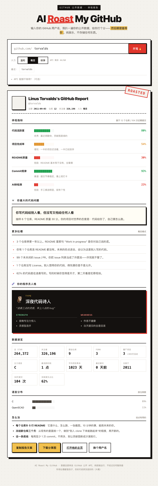

# 🔥 AI Roast My GitHub

> 输入你的 GitHub 用户名，它扒一遍你的公开数据，给你打个分——然后顺便羞辱你。
>
> *Enter your GitHub username. It reads your public data, grades you, and roasts you.*

**在线体验：[点击这里](https://f38137a13b64435da915adda80c622ca.sg2.agentos-app.run)**

纯前端 · 无后端 · 无追踪 · 不存储任何数据 · 单个 HTML 文件



---

## 它会给你出什么

一份体检报告卡：

```
Linus Torvalds's GitHub Report
────────────────────
代码活跃度       ████████░░ 80%
项目完成率       █████░░░░░ 54%
README质量       ███░░░░░░░ 30%
Commit规律       █████████░ 93%
AI味检测         ██░░░░░░░░ 23%

💀 你最大的代码问题：
你写代码给别人看，但没写文档给任何人看

🧬 你的程序员人格：🦉 深夜代码诗人
Strength: 夜晚专注力惊人 / 灵感型选手
Weakness: 作息不健康 / 白天提交的全是回滚
```

外加：真实数据速览（star / 关注者 / 僵尸项目 / 主力语言 / 最活跃时段）、语言分布，以及 3 条「怎么治」的实在建议。

## 5 项指标是怎么算的

不是随机数，全部来自 GitHub 公开 API 的真实数据：

| 指标 | 依据 |
| --- | --- |
| **代码活跃度** | 最近一次 push 的时间做指数衰减 + 近 90 天有更新的仓库占比 + 近 30 天 PushEvent 次数 |
| **项目完成率** | 每个仓库的 description / license / homepage / topics / 是否有实际代码 / 是否已弃坑 / GitHub Pages 加权平均 |
| **README 质量** | 抓取真实 README 正文，评估长度、标题层级、代码块、徽章、截图、关键章节完备度 |
| **Commit 规律** | 近 30 天的活跃天数 + 每日提交数的变异系数（越稳定分越高） |
| **AI 味检测** | emoji 密度、流行词命中（blazingly fast / 开箱即用 / 优雅……）、shields 徽章数、章节模板化程度 |

> **AI 味检测**这一项带 10 分基础分——毕竟这年头，谁不是呢。

## 11 种程序员人格

按优先级匹配，命中即停：

🔥 AI Vibe Coder · 🏗️ 项目坟场管理员 · ⭐ Star 收藏家 · 📚 README 美学家 · ⚙️ 人形 CI · 🦉 深夜代码诗人 · 🌪️ 突击型选手 · 🐢 沉默的工匠 · 🚀 启动很快的人 · 👻 空仓玩家 · 🧑‍💻 还在路上的开发者

## 三档火力

**温和** 说人话 · **毒舌** 直击痛点 · **核弹** 追加专属暴击（右上角印章从 `ROASTED` 变成 `DESTROYED`）

## 分享

- **下载分享图** — 一键导出 1080px 宽的 PNG 报告卡，直接发社交媒体
- **复制报告文案** — 纯文本版，方块进度条在终端和聊天窗口里都不跑版
- **`?u=用户名` 直达链接** — 别人点开就是自己的报告，不用手输：

```
https://f38137a13b64435da915adda80c622ca.sg2.agentos-app.run/?u=你的用户名
```

## 本地运行

没有构建步骤，没有依赖：

```bash
git clone https://github.com/Julian-Hao/ai-roast-my-github.git
cd ai-roast-my-github
open index.html        # macOS；其他系统直接双击 index.html
```

## 技术实现

- **单个 HTML 文件**，零依赖、零构建、零后端
- 直接调用 GitHub REST API（`api.github.com` 对浏览器开放 CORS，不需要任何服务端中转）
- 每次分析约 9–13 个请求：用户信息 + 仓库列表（分页）+ 公开事件 + 抽样 6 个仓库的 README
- 报告卡与分享图用原生 Canvas 绘制，不引入任何图形库
- 匿名 API 限制 60 次/小时，页面内置可选 Token 输入框（只存在浏览器 localStorage），可提升到 5000 次/小时

## 已知限制

- 只能读取**公开**数据。纯私有仓库的开发者，提交记录会被算作「无提交」——页面里已就此做了说明，不会冤枉人。
- GitHub 匿名 API 是按**访问者 IP** 限流的，所以流量大时个别人可能碰到配额提示。

## English

A single-file, zero-dependency web app that grades and roasts your GitHub profile from its public data — activity, completion rate, README quality, commit regularity, and an "AI flavor" score, plus a programmer personality and a downloadable share card.

**Live demo:** [open it](https://f38137a13b64435da915adda80c622ca.sg2.agentos-app.run)

Note: the UI is currently in Chinese. Pull requests for i18n are welcome.

## License

[MIT](LICENSE)
